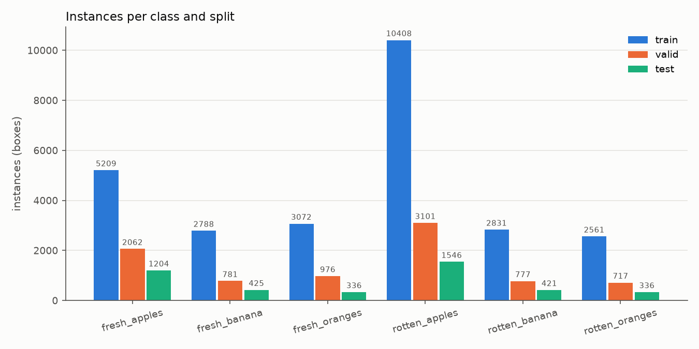
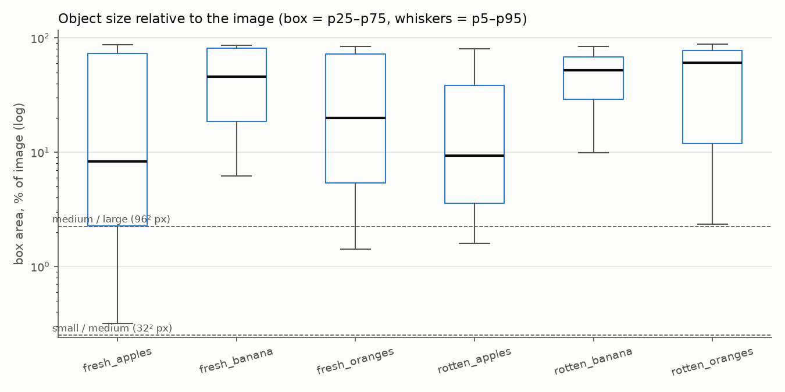
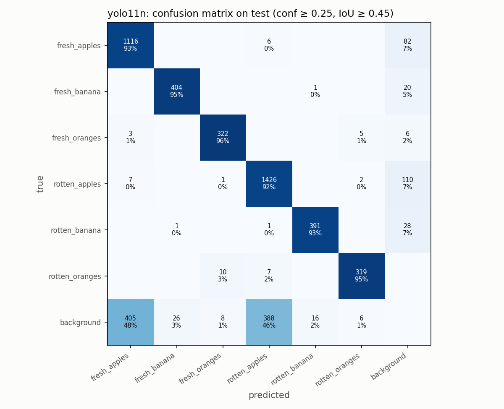
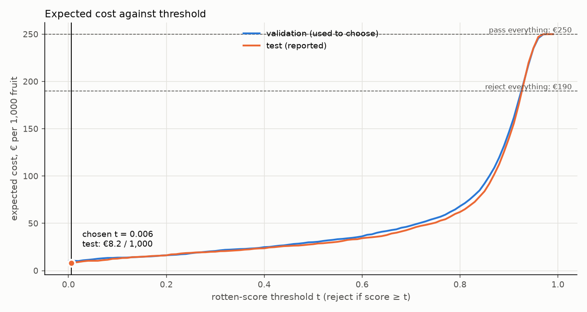
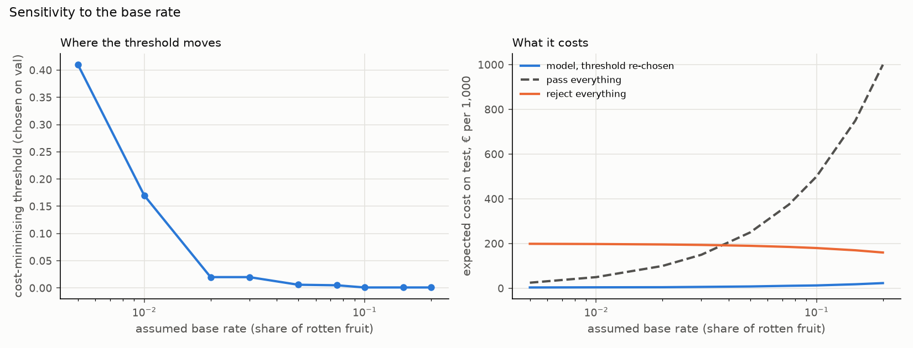
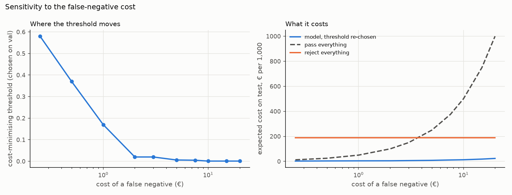

# Assignment 2 Report

- **Name**:
- **Student ID**:
- **Email**:
- **Group**: [BBADBA 5A | BBADBA 5B | PPLEDBA 5A | BDBA 3A]

## Business problem, and the cost of being wrong

*(Draft written with AI assistance from my decisions; to be reviewed and rewritten.)*

**The decision.** A fruit packing house sorts apples, oranges and bananas on a conveyor before packing them into retail packs (bags and trays) for a supermarket chain. Today, line workers look at each fruit and pull out the rotten ones. The model looks at a camera image of each fruit and makes the same call. Every fruit gets one of three outcomes:

- **pass**: packed for the supermarket;
- **fail**: an air ejector diverts it to the industrial stream (juice, purée, animal feed);
- **review**: diverted to an inspection station, where a worker decides.

The unit of decision is **one fruit**. The **positive class is "rotten"** (`rotten_apples` + `rotten_banana` + `rotten_oranges`).

**Who acts on it.** The ejector acts automatically on pass and fail. The line's quality operator handles the review lane. The packing house carries the cost of both kinds of error: it loses the value of fruit it diverts, and it pays the supermarket's claims for rotten fruit that gets through.

**Cost of each outcome (per fruit)**

| Outcome | Cost | Why |
|---|---:|---|
| False positive: sound fruit sent to industry | **€0.20** | Golden apples leave the packing house at about €1.01/kg, and navel oranges at €0.80/kg (MAPA weekly price bulletin, week 6/2025). One piece weighs about 0.2 kg, so it is worth about €0.20 as fresh fruit. Industry pays only a few cents per kilo, and the washing and grading already done is lost. |
| False negative: rotten fruit packed and shipped | **€5.00** | EU marketing standard for apples, Class I: at most 1% of a lot may be affected by decay. A pallet holds about 800 kg (about 4,000 apples) worth about €800, so it breaks tolerance with about 40 rotten fruit. A non-compliant load is typically rejected or taken at a 20–30% discount, about €200. €200 / 40 ≈ **€5 per rotten fruit that slips through.** |
| True positive / true negative | €0 | Costs are measured against a perfect sorter. A rotten fruit sent to industry was worth nothing as fresh fruit anyway, and a sound fruit that passes is sold normally. |

**The asymmetry: a false negative costs 25 times a false positive.** Throwing away a good apple loses its margin. Shipping a rotten one puts a whole pallet at risk and strains the relationship with the retailer. The model should therefore err towards rejecting. A simple check makes this concrete: with these costs, rejecting a fruit pays off as soon as the probability that it is rotten exceeds 0.20 / (0.20 + 5.00) ≈ **3.8%**. That is a low bar, so recall on the rotten class matters far more than precision.

**Base rate: 5% of incoming fruit is rotten.** Commercial apple storage loses 4–12% of fruit, and 60–80% of those losses are fungal decay, which gives about 2–10% rotten fruit. I take 5% as the midpoint. The dataset's own share, 54% of test boxes, is not a base rate. Even at 5%, unsorted fruit would break the 1% tolerance five times over, which is why sorting is needed at all.

**Assumptions that could change the answer** *(break-even values from the sensitivity sweep, see "Cost matrix and operating point")*:

- I assumed **FN = €5** because a pallet breaks the 1% tolerance at about 40 rotten fruit, at a cost of about €200. If FN falls to **€3 or below**, the cost-minimising threshold rises from 0.006 to 0.02. At **€1** it rises to 0.17. The model beats both reference policies at every FN cost from €0.25 to €20.
- I assumed a **base rate of 5%** because of the storage-loss studies above. If it falls to **3% or below**, the threshold rises to 0.02. At **1%** it rises to 0.17. At **10% or more** it drops to the lowest confidence the model reports (0.001).
- I assumed **one cost for all three fruit types**. Bananas and oranges are worth roughly the same per piece as apples, and the dataset is dominated by apples.

Sources: [MAPA weekly fruit & vegetable price bulletin, week 6/2025](https://www.mapa.gob.es/en/ganaderia/estadisticas/62025boletinsemanaldepreciosdefyh3-10febrero_tcm38-701364.pdf); [EU/UNECE marketing standard for apples (Reg. 543/2011, Annex I)](https://assets.publishing.service.gov.uk/government/uploads/system/uploads/attachment_data/file/869232/marketing-standard-apples.pdf); [Clarifresh, retailer rejections at a 20–30% discount](https://clarifresh.com/blog/repacking-fresh-produce/); [HortScience 56(5): postharvest losses of apples in commercial storage](https://journals.ashs.org/view/journals/hortsci/56/5/article-p608.xml).

## Dataset

- **Workspace / project / version**: `project-irggm` / `-w4yds` / version 1 (2025-03-18), used as published (not forked).
- **Link**: https://universe.roboflow.com/project-irggm/-w4yds/dataset/1
- **Task / licence**: object detection, Public Domain. Export format `yolov11`, 640×640 (stretch), no Roboflow augmentations.
- **Classes (6)**: `fresh_apples`, `fresh_banana`, `fresh_oranges`, `rotten_apples`, `rotten_banana`, `rotten_oranges`.
- **What one image is**: a photo of one or more pieces of fruit; each box is one fruit labelled with its type and state. One box is the unit we decide on.

**Why it serves the decision** *(draft, AI-assisted)*.

The labels encode exactly the call the line makes: which fruit (box) and whether it is rotten (class). The model therefore outputs one decision per fruit, not one per image, and that matches how the ejector acts.

It covers the three fruit types a mixed packing line handles, with both states for each. It also includes images where fresh and rotten fruit sit side by side, as they do on a belt.

What it does not match is the camera: none of the images come from a conveyor. The next section shows what that limits.

## What the dataset's composition implies

All figures computed from the labels by `dataset_stats.py` (outputs in `artifacts/dataset/`).

**Splits**

| Split | Images | Instances | Empty images | Multi-class images | Images with an external-augmentation prefix |
|---|---:|---:|---:|---:|---:|
| train | 16,609 (69.5%) | 26,869 | 964 | 232 | 8,502 (51%) |
| valid | 4,852 (20.3%) | 8,414 | 277 | 63 | 2,400 (49%) |
| test | 2,443 (10.2%) | 4,268 | 140 | 34 | 1,186 (49%) |

**Instances per class**

| Class | Train (published) | Valid (published) | Test | Share of all boxes | Train (cleaned) | Valid (cleaned) |
|---|---:|---:|---:|---:|---:|---:|
| fresh_apples | 5,209 | 2,062 | 1,204 | 21.4% | 4,332 | 1,846 |
| fresh_banana | 2,788 | 781 | 425 | 10.1% | 1,448 | 421 |
| fresh_oranges | 3,072 | 976 | 336 | 11.1% | 2,224 | 720 |
| rotten_apples | 10,408 | 3,101 | 1,546 | 38.1% | 8,956 | 2,703 |
| rotten_banana | 2,831 | 777 | 421 | 10.2% | 1,522 | 401 |
| rotten_oranges | 2,561 | 717 | 336 | 9.1% | 1,481 | 394 |

"Cleaned" = after removing every train/valid image that is a copy of a test image (see leakage below). The test split is used unchanged.

**Object size relative to the image**

| Class | Median box area | p25 – p75 | Small (<32² px) | Medium | Large (>96² px) | Boxes < 8×8 px |
|---|---:|---:|---:|---:|---:|---:|
| fresh_apples | 8.3% | 2.3 – 73.0% | 3.7% | 21.2% | 75.1% | 0 |
| fresh_banana | 45.9% | 18.7 – 81.1% | 0.1% | 0.8% | 99.1% | 3 |
| fresh_oranges | 20.0% | 5.4 – 72.7% | 0.2% | 11.4% | 88.4% | 7 |
| rotten_apples | 9.4% | 3.6 – 38.7% | 0.1% | 11.6% | 88.3% | 15 |
| rotten_banana | 52.4% | 29.2 – 68.4% | 0.2% | 0.1% | 99.7% | 8 |
| rotten_oranges | 60.7% | 11.9 – 77.6% | 0.1% | 4.8% | 95.1% | 3 |

**Train/test leakage**

| Check | Test images |
|---|---:|
| Same original photo in train/valid, by filename (augmentation prefix and `.rf.<hash>` stripped) | 1,383 |
| Near-identical image in train/valid, by perceptual hash (dHash, ≤ 3 of 64 bits) | 556 |
| … of which missed by the filename check (burst photos, renamed copies) | 184 |
| **Leaked in total** | **1,567 of 2,443 (64%)** |

By source: all 1,360 `Screen-Shot` test images leak, as do 142 of 305 `IMG_*` phone photos, while none of the 46 `YYYYMMDD_HHMMSS` phone photos do.

**Fix applied.** The training pipeline drops from train and valid every image whose base name matches a test image or whose dHash is within 3 bits of one: 5,938 train and 1,689 valid images (list in `artifacts/dataset/excluded_train_val.csv`). That leaves 10,671 train / 3,163 valid / 2,443 test images. The download is the published version, unchanged; the filter is deterministic and runs inside `train.py`, so anyone re-running the pipeline gets the same split.

**What this implies** *(draft written with AI assistance, to be reviewed and rewritten)*

1. **The official test split overstates performance.** About two thirds of the test images are the same photo as a train image, either rotated, flipped or noised, or taken a second later in a burst. The screenshot source leaks completely: this suggests Roboflow's split was made *after* someone else had augmented the images, so copies of one photo landed on both sides. A model can score well on those images by recognising the photo, not by judging rot, and a leaked test underestimates false negatives, which would push the cost-optimal threshold to an over-optimistic place. I considered two fixes: evaluating only on the 876 test images with no copy in train/valid, or keeping the whole test split and removing the copies from train/valid instead. I chose the second. It keeps 336–425 test boxes for every banana and orange class, compared with 57–133 in the de-duplicated test, where recall would carry a ±10–13 point uncertainty. The price is training on 10,671 images instead of 16,609, but most of what was removed are rotated or flipped copies of the same photos, which add little new information.
2. **The test split still contains copies of itself.** An original and its rotated versions can all sit in test. That does not bias the metrics, but the effective sample size is smaller than 2,443 images, so per-class intervals are wider than the raw counts suggest. Train and valid also share copies with each other. This only affects early stopping and model selection, and the test split is not affected.
3. **Apples dominate.** Apples make up 64% of the test boxes, and `rotten_apples` alone is 36%. The pooled "rotten" result will lean on apples, so I report each class separately before pooling.
4. **The class mix is not the production base rate.** Rotten fruit makes up 57% of the boxes overall and 54% of the test. On a packing line it is a small fraction. Precision measured here will be far higher than in production, so the cost analysis uses the test's TPR and FPR together with an assumed base rate, not the test's raw precision.
5. **The images do not look like a conveyor belt.** The dataset mixes screenshots of web images (57% of train), phone photos held in a hand or on a table, and studio shots on white backgrounds. Most fruit is large: the median box covers 8–60% of the image, and fewer than 4% of boxes are "small" in COCO terms. On a line camera every fruit would have a similar, smaller size, with a consistent background and lighting. The test split cannot tell us how the model behaves under that shift. That needs a pilot on real line images.
6. **Labels are mostly clean but not perfect.** There are 36 boxes under 8×8 px, which are almost certainly annotation errors, and 1,381 images with no boxes (background-only negatives). Their effect on the metrics is negligible, so I leave the dataset as published.
7. **Some images mix fresh and rotten fruit.** Only 30 test images do (226 in train). Since the decision is made per fruit, these images are useful: they show whether the model can separate neighbouring fruit. But they are too few to measure that reliably.

## Finetuning and baselines

*(Draft written with AI assistance from my decisions; to be reviewed.)*

**Task and model.** I use object detection, not classification, because the line decides fruit by fruit and an image can hold several fruit, sometimes fresh and rotten side by side. I finetuned both `yolo11n` and `yolo11s` from their COCO checkpoints on the cleaned split. I fixed the selection rule before seeing any result: keep the model with the higher mean recall over the three rotten classes on the cleaned validation split, because a missed rotten fruit is the expensive error.

- **yolo11n**: 0.941 rotten recall on val, mAP50 0.959.
- **yolo11s**: 0.939 rotten recall on val, mAP50 0.965.

The rule picks **yolo11n**. The 0.15-point gap is noise, so in practice the two are tied. The nano model is also about three times smaller, which matters for a camera on a line that has to keep up with the belt. `weights/best.pt` is yolo11n, and yolo11s is kept as `weights/yolo11s_comparison.pt`.

**Where and how it was trained.**

| | |
|---|---|
| Hardware | Google Colab, NVIDIA Tesla T4; PyTorch 2.11 (CUDA 13.0), Python 3.13, Ultralytics 8.4 |
| Settings | 50 epochs, early stopping patience 10, image size 640, batch 32, seed 0, deterministic; Ultralytics' default optimiser and augmentations |
| Training time | about 2.1 h (yolo11n) and 2.4 h (yolo11s) |
| Data | cleaned train (10,671 images) and cleaned valid (3,163 images); test (2,443 images) untouched |

Neither run stopped early. The best validation mAP50-95 came at epoch 50 for yolo11n and epoch 48 for yolo11s. The models were therefore still improving slightly when training ended (see "Limitations").

**Results on the same test split** (all 2,443 images, all 6 classes; precision and recall at the max-F1 confidence, AP is threshold-free):

| Model | Precision | Recall | AP50 | mAP50-95 |
|---|---:|---:|---:|---:|
| **yolo11n finetuned (chosen)** | **0.926** | **0.915** | **0.943** | **0.794** |
| yolo11s finetuned | 0.928 | 0.914 | 0.945 | 0.802 |
| yolo11n COCO, zero-shot | 0.236 | 0.222 | 0.189 | 0.138 |
| Trivial: predict nothing | 0 | 0 | 0 | 0 |

**The baselines.**

- **COCO zero-shot.** COCO knows "apple", "banana" and "orange" but has no notion of rot. I mapped each of those three COCO classes to the matching `fresh_*` class, so the zero-shot model can at best find the fruit and call it fresh. That is what it does: its rotten AP is zero by construction. Even at finding the fruit it is weak, with fresh AP50 of 0.37. It labels many rotten apples as oranges (113) or bananas (27), because a brown, wrinkled apple does not look like COCO's apples.
- **Predict nothing.** This baseline scores zero on every metric.

As a sorter, both baselines amount to "pass everything", which costs €250 per 1,000 fruit at a 5% base rate.

**Is the gap as large as I expected?** It is larger in absolute terms, but the direction was never in doubt, since neither baseline can output "rotten" at all.

The finetuned numbers are high (AP50 0.94), and I trust them less than they look. The test images are web screenshots and hand-held photos rather than conveyor images, and the test split still contains rotated copies of its own images (see the dataset section). These results show that the model learned to tell rot from fresh on this kind of image. They do not show that it will reach 0.94 on a real belt.

## Per-class evaluation and failure modes

*(Draft written with AI assistance; to be reviewed.)*

**Positive class: rotten** (the three `rotten_*` classes pooled). The table shows the test split for the chosen yolo11n model. Precision and recall are taken at the max-F1 confidence.

| Class | Test boxes | Precision | Recall | AP50 | mAP50-95 |
|---|---:|---:|---:|---:|---:|
| fresh_apples | 1,204 | 0.808 | 0.876 | 0.912 | 0.755 |
| fresh_banana | 425 | 0.970 | 0.922 | 0.954 | 0.754 |
| fresh_oranges | 336 | 0.967 | 0.960 | 0.966 | 0.836 |
| rotten_apples | 1,546 | 0.868 | 0.870 | 0.935 | 0.779 |
| rotten_banana | 421 | 0.970 | 0.916 | 0.939 | 0.776 |
| rotten_oranges | 336 | 0.975 | 0.943 | 0.953 | 0.866 |
| **rotten (pooled, positive)** | **2,303** | **0.921** | **0.881** | **0.947** | **0.799** |
| fresh (pooled) | 1,965 | 0.881 | 0.885 | 0.935 | 0.770 |

**Detection confusion matrix** (yolo11n, test, confidence ≥ 0.25, IoU ≥ 0.45; rows are the true class, columns the predicted class):

| true ↓ / predicted → | fresh_apples | fresh_banana | fresh_oranges | rotten_apples | rotten_banana | rotten_oranges | missed |
|---|---:|---:|---:|---:|---:|---:|---:|
| fresh_apples | **1,116** | 0 | 0 | 6 | 0 | 0 | 82 |
| fresh_banana | 0 | **404** | 0 | 0 | 1 | 0 | 20 |
| fresh_oranges | 3 | 0 | **322** | 0 | 0 | 5 | 6 |
| rotten_apples | 7 | 0 | 1 | **1,426** | 0 | 2 | 110 |
| rotten_banana | 0 | 1 | 0 | 1 | **391** | 0 | 28 |
| rotten_oranges | 0 | 0 | 10 | 7 | 0 | **319** | 0 |
| background (no fruit) | 405 | 26 | 8 | 388 | 16 | 6 | – |

**What carries the headline number, and what drags it.**

- **Apples carry the result in both directions.** They are 64% of the test boxes, so the pooled numbers are mostly apple numbers. They are also the weakest fruit:
  - `fresh_apples` has the lowest precision (0.81);
  - `rotten_apples` has the lowest recall of the rotten classes (0.87).
- **Oranges and bananas are easier.** Their precision is 0.97 or higher.

**What the model gets wrong, in order of how much it matters.**

1. **Missing a fruit altogether, not mistaking its state.** The model rarely calls a rotten fruit fresh or a fresh fruit rotten: 19 rotten fruit were called fresh and 12 fresh fruit were called rotten, out of 4,268 fruit. Almost all its errors are detection errors. At confidence 0.25, 246 fruit get no box at all, 110 of them rotten apples. For the business this is the error that matters, because an undetected rotten fruit passes. At the low threshold I actually use (next section), most of these fruit do get a weak rotten box. Even so, **2.1% of rotten fruit never receive any rotten box**, and that is the floor on what the model can catch. It is worst for bananas: 4.5% of rotten bananas are never caught, against 1.4% of apples. Banana boxes are large and often cover a bunch, so a box that covers the bunch does not line up with each labelled banana.
2. **Spurious boxes on background, mostly apples.** There are 405 fresh-apple and 388 rotten-apple predictions where no labelled fruit is. Many sit in the screenshot images that show piles of apples, where not every apple is labelled, so some of these "errors" are missing labels. On a line, though, a spurious rotten box near a good fruit could eject it. My fruit-level cost analysis counts errors per labelled fruit, so it does not charge for these (see "Limitations").
3. **Oranges are the one real state confusion.** 10 rotten oranges are called `fresh_oranges` and 5 fresh oranges are called `rotten_oranges`. Early mould on an orange is a small, pale patch on a textured skin, which is harder to see than a brown patch on an apple. Fresh oranges also have the highest false-reject rate at my threshold (2.1%, against 1.0% for apples).

**yolo11s against yolo11n.** yolo11s finds a few more fresh apples (fresh_apples recall 0.90 against 0.88), but the two models' failure patterns are the same, so the larger model does not fix any of the weaknesses above.

## Cost matrix and operating point

*(Draft written with AI assistance from my decisions; to be reviewed.)*

**Costs and base rate** (justified in "Business problem"): false positive **€0.20**, false negative **€5.00**, true positive and true negative €0, base rate **5%**.

**From detections to one score per fruit.** The cost is per fruit, so each labelled fruit gets a **rotten score**: the highest confidence of any rotten-class box that overlaps it with IoU ≥ 0.5, or 0 if there is none. A fruit is rejected when its score is at least *t*.

**Cost per 1,000 fruit.** The expected cost is

> 1,000 × [ π · (1 − TPR(t)) · €5.00 + (1 − π) · FPR(t) · €0.20 ]

where TPR and FPR come from the data and π = 5% comes from the business framing. The dataset's 54% rotten share would overstate how much catching rot is worth.

**How the threshold was chosen.** I swept *t* over 108 values: 0.001 to 0.009 in steps of 0.001, then 0.01 to 0.99 in steps of 0.01. I took the minimum cost **on the cleaned validation split** and then report that threshold's cost **on the test split**, so the test set plays no part in choosing.

**Operating point: reject when the rotten score is at least t = 0.006.**

| t | Test TPR (rotten rejected) | Test FPR (fresh rejected) | Test € / 1,000 |
|---:|---:|---:|---:|
| 0.001 | 97.9% | 1.2% | 7.64 |
| **0.006 (chosen on val)** | **97.6%** | **1.1%** | **8.21** |
| 0.02 | 97.1% | 1.0% | 9.10 |
| 0.10 | 95.6% | 0.9% | 12.70 |
| 0.50 | 89.3% | 0.7% | 27.96 |
| pass everything | 0% | 0% | 250 |
| reject everything | 100% | 100% | 190 |

**How to read it.**

- **The model cuts the cost of sorting about 30-fold.** €8.2 per 1,000 fruit against €250 for not sorting and €190 for throwing everything to industry. It also leaves about 0.12% rotten fruit in the packed product, far inside the 1% EU tolerance.
- **The threshold is tiny because the costs are lopsided.** The cost curve keeps falling as *t* goes down: each extra rotten fruit caught saves €5, while each fresh fruit lost costs only €0.20. In practice the model rejects a fruit as soon as it sees *any* hint of rot. On a calibrated probability the break-even point would be 3.8%. YOLO's confidences are not calibrated probabilities, though: a rotten fruit the model half-misses gets a low score such as 0.01 rather than a probability like 0.3. That is why the cost-optimal *t* has to come from the sweep and not from the formula.
- **Validation and test disagree a little, but the decision does not change.** On validation the minimum is at 0.006. On test it is at 0.001, the lowest confidence the model reports. Validation has more fresh fruit with a faint rotten box: its FPR at 0.006 is 3.5%, against 1.1% on test. On test the curve is flat between 0.001 and 0.02, from €7.6 to €9.1, so choosing on validation costs at most about €0.6 per 1,000.

**Sensitivity: which assumption matters most.** I re-chose the threshold on validation while moving one assumption at a time, and report the resulting test cost.

| Base rate | 0.5% | 1% | 2% | 3% | **5%** | 7.5% | 10% | 20% |
|---|---:|---:|---:|---:|---:|---:|---:|---:|
| best t | 0.41 | 0.17 | 0.02 | 0.02 | **0.006** | 0.005 | 0.001 | 0.001 |
| model € / 1,000 | 3.7 | 4.4 | 4.9 | 6.3 | **8.2** | 11.2 | 12.8 | 23.2 |
| pass everything | 25 | 50 | 100 | 150 | 250 | 375 | 500 | 1,000 |

| FN cost | €0.25 | €0.50 | €1 | €2 | €3 | **€5** | €7.5 | €10 | €20 |
|---|---:|---:|---:|---:|---:|---:|---:|---:|---:|
| best t | 0.58 | 0.37 | 0.17 | 0.02 | 0.02 | **0.006** | 0.005 | 0.001 | 0.001 |
| model € / 1,000 | 2.4 | 3.5 | 4.3 | 4.8 | 6.2 | **8.2** | 11.2 | 13.0 | 23.6 |
| pass everything | 12.5 | 25 | 50 | 100 | 150 | 250 | 375 | 500 | 1,000 |

**What I conclude from the sensitivity tables.**

- **The base rate and the FN cost act together.** They enter the cost only through the expected loss of passing a fruit, π × C_FN (€0.25 per fruit), compared with the loss of rejecting a fresh one, (1 − π) × C_FP (€0.19). Halving either has the same effect, which is why the two tables move in step.
- **The decision to use the model does not depend on these assumptions.** It beats both reference policies across the whole range, by a factor of 5 or more.
- **The threshold does depend on them.** If rotten fruit is rarer than about 3%, or a shipped rotten fruit costs less than about €3, the threshold should move up to around 0.02. At 1% or €1 it should move to 0.17. Keeping *t* = 0.006 when the truth is a 10–20% base rate costs an extra €1.3–2.9 per 1,000, which is small.
- **The assumption that would most change my answer is the FN cost.** It is the least certain figure: it depends on how the retailer actually treats a non-compliant pallet. If the retailer only refunds the bad fruit instead of discounting the whole load, FN falls towards €1, and the right threshold is about 0.17, not 0.006.

## What a person still has to check

*(Draft written with AI assistance from my decisions; to be reviewed.)*

**Three outcomes.** Each fruit's rotten score *s* decides it:

- **pass** if *s* < 0.001;
- **review** if 0.001 ≤ *s* < 0.58;
- **reject** to industry if *s* ≥ 0.58.

A diverter sends the fruit to review onto a side table, where an operator looks at it and either returns it to the line or drops it in the industry bin.

**How the two thresholds were chosen.**

- I searched every pair of thresholds on the grid on the **validation** split, plus "no automatic reject". For each pair I minimised the expected cost, which includes the cost of the check and the reviewer's own mistakes.
- The search was capped at what one person can check: 7 productive hours ÷ 4 s = 6,300 fruit, which is **12.6%** of 50,000 a day.
- The cap did not bind: the unconstrained search lands on the same thresholds.
- The lower threshold is the lowest confidence the model reports. In plain terms: *if the model sees any trace of rot, a person looks at it, unless it is fairly sure (0.58 or more), in which case it rejects on its own.*

**Review assumptions** (my choices):

| Assumption | Value | Why |
|---|---|---|
| Fruit per day | 50,000 | One mid-sized line, one 8 h shift |
| Time per check | 4 s | Pick up, turn, look, put down at a physical table |
| Reviewer errors | 5% of rotten passed, 5% of fresh rejected | An operator looking closely at one fruit, with the hint that it is suspect |
| Full manual inspection (no model) | 1 s per fruit, 20% of rotten missed, 5% of fresh rejected | Watching a moving belt; fatigue and speed make misses common |
| Labour | €14/h, 8 h paid / 7 h productive (≈ €0.018 per 4-second check) | Loaded cost of an agri-food line worker in Spain |

**The load.** On the test split, at a 5% base rate, the band sends **1.3% of the fruit to review**. That is **656 fruit a day, or about 44 minutes of one person's time**. Per 1,000 fruit:

| | pass | review | reject |
|---|---:|---:|---:|
| truly rotten (50) | 1.1 | 5.4 | 43.6 |
| truly fresh (950) | 938.4 | 7.7 | 3.9 |

About 41% of what reaches the table really is rotten, so the reviewer's work is not wasted. Most of the rotten fruit in the band are rotten apples: 14.5% of them land there.

**Is that realistic?** Yes, and it is not a full-time job. 44 minutes a day is a task for an operator already working on the line, for example the person who handles the industry bins, not a new hire. I therefore price the review by the time it takes, not as a whole extra shift. The load also holds if rot is more common than I assumed. At a 20% base rate the band would send about 2.8% of the fruit (about 1,400 a day, 1.6 h), still well inside one person's capacity.

The practical constraint is not the total load but its timing. Suspect fruit arrives in bursts, so the side table needs a buffer chute that holds a few dozen fruit.

**My design priced against the three alternatives** (test-split rates, 50,000 fruit a day, 5% base rate):

| Way of running the line | People | Checked / day | Rotten shipped / day | Fresh lost / day | Rotten in packed fruit | Errors € / day | Labour € / day | **€ / 1,000** |
|---|---:|---:|---:|---:|---:|---:|---:|---:|
| Do nothing | 0 | 0 | 2,500 | 0 | 5.0% | 12,500 | 0 | **250.0** |
| A person checks every fruit | 2 | 50,000 | 500 | 2,375 | 1.1% | 2,975 | 224 | **64.0** |
| Model alone (reject if s ≥ 0.006) | 0 | 0 | 61 | 532 | 0.12% | 410 | 0 | **8.2** |
| **Model + review (my design)** | part of 1 | 656 | 67 | 213 | 0.13% | 376 | 12 | **7.7** |

**What the comparison says.**

- **Checking everything by hand is the real alternative, and it is not good enough.** It takes two full-time people (50,000 checks × 1 s is 13.9 h). Those people still miss 20% of the rot, so the packed fruit ends up at 1.1% rotten, over the 1% EU tolerance. It costs eight times as much as the model.
- **The model alone is already far better** than manual inspection: it ships 61 rotten fruit a day instead of 500.
- **Adding the review band saves a further €23 a day**, roughly €5,800 a year over 250 working days. The saving comes almost entirely from **good fruit**: 319 fewer fresh fruit a day are thrown to industry. It costs about 6 more rotten fruit shipped a day, which slip past the reviewer's 5% error. The quality of the packed fruit barely changes (0.12% → 0.13%).
- **The band only pays off if checks stay quick.** It pays as long as a check takes less than about 12 seconds. If the reviewer's error rate or the check time turns out much worse in a pilot, running the model alone is the fallback, and it costs only €0.46 more per 1,000.

## Limitations & next steps

*(Draft written with AI assistance; to be reviewed.)*

1. **No conveyor images.** Every number above comes from web screenshots and hand-held photos with large fruit. On a line camera the fruit is small, uniform and moving, under fixed lighting. **Next step:** a two-week pilot that photographs the real belt. I would label about 1,000 of those fruit, finetune on them, and recompute TPR, FPR and both thresholds on that data before letting the model act on its own. Until then, I would only run it alongside the current manual check.
2. **The test split is smaller than it looks, and validation is not independent.** Test still contains rotated copies of its own images, and train and validation share copies, so the error bars are wider than 2,443 images suggest. The val-vs-test difference in FPR (3.5% against 1.1%) shows the threshold choice is noisy. **Next step:** re-split by source photo, putting all copies of a photo in one split, and bootstrap the cost by photo family to put an interval on the €8.2 figure.
3. **Spurious detections are not costed.** The fruit-level analysis scores labelled fruit only. The 400 or so spurious rotten boxes on background in test would, on a line, risk ejecting a neighbouring good fruit. **Next step:** evaluate per lane or per tray on line images, where every detection triggers an action and is costed as such.
4. **2.1% of rotten fruit is invisible to the model** (4.5% for bananas). No threshold can catch these. **Next step:** more rotten-banana images with one box per fruit, and possibly a second-stage classifier on each fruit crop, which would see rot at higher resolution than a whole-image detector.
5. **Scores are not probabilities.** The threshold of 0.006 is very close to the lowest confidence the model reports (0.001), so it depends on that setting. The app uses the same setting so the numbers match. **Next step:** calibrate the scores on line data (Platt or isotonic scaling), so the threshold can be read against the 3.8% break-even point.
6. **One cost for every fruit and every week.** Prices are seasonal, and a banana is not an apple. **Next step:** costs per fruit type, refreshed from the MAPA bulletin, and a threshold per type. The per-class rates are already in `artifacts/eval/`.
7. **Training had not fully converged.** The best epochs were 48–50 of 50. **Next step:** 100 epochs. I expect a small gain, mostly on apples.
8. **Review times and error rates are assumptions.** **Next step:** time-study the review table during the pilot. The band pays only while a check takes less than about 12 s.

## Generative AI use disclosure

I used **Claude Code (Anthropic, Claude Opus model)** throughout this assignment, as a coding and writing assistant. The instructor allowed AI drafting of the report for this assignment.

**What the AI did:**

- Wrote the code: `dataset_stats.py`, `train.py`, `evaluate.py`, `costs.py`, `app.py`, and the Colab instructions (`COLAB.md`).
- Proposed the leakage check, using filename and perceptual hash, and the options for fixing it.
- Ran the analyses locally.
- Drafted the text of this report from my decisions and the pipeline's outputs.

**What I decided:** I made every decision the assignment grades, choosing each time between options the AI laid out with their implications:

- the business framing (packing house selling to a supermarket, rejected fruit going to industry);
- the costs (FP €0.20, FN €5.00, TP and TN €0) and the 5% base rate;
- how to fix the leakage (clean train/val, keep test whole);
- the training budget (50 epochs, patience 10) and the model-selection rule (rotten recall on val);
- the COCO mapping and how a fruit's score is built;
- choosing the threshold on validation and reporting it on test;
- the review set-up: physical table, 4 s per check, 5%/5% reviewer error, 20%/5% for full manual inspection, €14/h with 7 productive hours, one shift and one reviewer;
- treating the review as part of an existing operator's job.

Training ran on Google Colab.

I checked the numbers in this report against the files in `artifacts/`. I can explain each decision and figure without the code in front of me.
